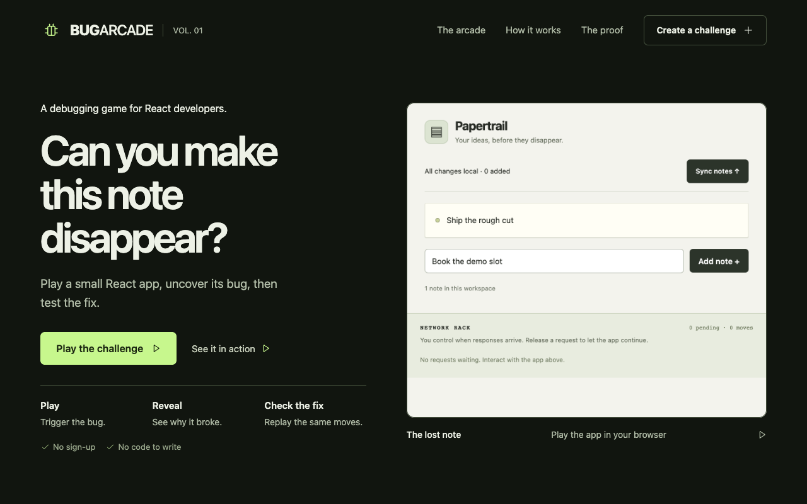

# BugArcade

**Break it. Understand it. Prove the fix.**

Can you make a React app lose your note in three moves? BugArcade turns real UI bugs into playable debugging challenges, then gives you the exact replay and regression test that prove the fix works.



[Get started](docs/GETTING_STARTED.md) · [Watch the demo](https://youtu.be/RnbcI01d7oE) · [Explore captured Meta proof](proof/index.html) · [How it works](docs/ARCHITECTURE.md)

## Play the bug, then make the fix earn it

1. **Play.** Explore a real small app and control when API responses arrive. Catch the bug within the move target.
2. **Reveal.** Follow the action timeline, inspect the observed failure and understand the cause.
3. **Check the fix.** Replay the same actions against the fixed app and keep the regression test.

Earn stars for catching a bug, meeting its move target and checking the fix. Hints, reset and best moves make each case approachable. Personal progress stays in your browser; captured assertion results remain a separate verification record.

| Five included cases | What you are trying to break |
| --- | --- |
| The disappearing note | A sync response loses a note added while it was pending |
| Optimistic rollback | An older failed rename overwrites a newer successful change |
| Search response race | Out-of-order responses display results for the wrong query |
| Duplicate submission | A pending request accepts the same order twice |
| Effect cleanup race | A previous view's response updates the next view |

Each case includes buggy and fixed React source, a deterministic API schedule and an executable regression test. The five gallery plans are authored and reproducible. [Inspect the evidence](docs/EVIDENCE.md).

## Run it

Requires **Node.js 22.14+**, **Python 3.12–3.13** and [uv](https://docs.astral.sh/uv/). Playing the included cases needs no credentials or cloud spending.

```sh
git clone https://github.com/himanshu748/bugarcade.git
cd bugarcade
npm ci --ignore-scripts
uv sync --extra dev --extra cloud
npx playwright install chromium
npm start
```

Open **[localhost:5173](http://127.0.0.1:5173)** and choose **The disappearing note**. Ctrl+C stops the frontend, fixture server and API. [Alternate ports, checks and troubleshooting](docs/GETTING_STARTED.md).

After cloning, open the repository’s [proof/index.html](proof/index.html) or [proof/heldout/index.html](proof/heldout/index.html) locally in a browser for a dependency-free tour. The portable pages include playable cartridges, actual model proposals and test output. Playback makes no new model call.

## Meta plans. The browser verifies.

The creator accepts an authorized Starter v1 app and a short bug recording. **Muse Spark Open** reasons over source and timestamped frames, then proposes browser actions and a candidate failure assertion. Accepted actions drive the browser executor. A deterministic verifier decides whether the bug reproduced; it rejects timeouts, invalid actions and incomplete workflows.

The pipeline repeats the failure, removes unnecessary actions while preserving the intended assertion, checks the fixed counterpart and packages the challenge, replay, trace and executable regression test.

Two investigations used Muse Spark Open through a **Modal Shared Endpoint**:

| Investigation | Proposed → minimized actions | Final buggy / fixed trials | Model calls |
| --- | --- | --- | --- |
| Known lost-note case | 4 → 3 | 3 failures / 3 passes | 1 |
| Separate first-party coupon case | 3 → 2 | 3 failures / 3 passes | 1 |

[Follow the model proposals into browser actions and regression results](docs/EVIDENCE.md). The coupon app was kept outside the gallery and supplied planner examples, with no action plan or reproduction hints in the model input.

**Recorded mode** plays the included seeds without credentials and labels their authored plans. **Live-agent mode** starts disabled and requires backend-only provider access, an approved finite budget and a prebuilt Modal image. Model calls stay outside submitted-code sandboxes.

## Bring a supported app

BugArcade supports small, explicitly authorized React/TypeScript apps through the documented [Starter v1 interface](docs/STARTER.md):

```text
manifest.json
buggy/App.tsx
fixed/App.tsx
README.md          # optional
```

Supply a short MP4/WebM recording and optional hints. The creator provides the fixed counterpart. Apps use React imports, stable test IDs and the controlled `api.request` interface. Custom dependencies, build scripts, SSR and arbitrary repository layouts are outside v1. The recording guides investigation; it does not establish a successful reproduction.

## Built for inspectable outcomes

- **React + TypeScript** arcade with keyboard access, responsive layouts, visible focus and reduced-motion support.
- **FastAPI + SQLite** orchestration with explicit job states, idempotency, cancellation and persisted reservations.
- **Playwright** action execution, controlled API scheduling, immutable assertions and bounded minimization.
- **Modal Sandboxes** for submitted source, with pinned dependencies, blocked external egress, resource limits and protected receipts. The local runner is for trusted seeds and provides no equivalent isolation.

BugArcade runs as a single-user developer workbench. Submitted apps use a bounded sandbox; the local runner is intended for trusted fixtures. [Architecture](docs/ARCHITECTURE.md) · [Security boundaries](docs/SECURITY.md) · [Runtime evidence](proof/runtime-summary.json).

## Develop and verify

```sh
npm run lint
npm run typecheck
npm run build
.venv/bin/ruff check backend tests scripts
.venv/bin/pytest
npm run test:worker
node --experimental-strip-types --test tests/arcade-progress.test.mjs tests/job-evidence.test.mjs
```

[Browser tests and seed verification](docs/GETTING_STARTED.md#run-checks) cover the complete player journey and repeatable buggy/fixed checks. [Evidence](docs/EVIDENCE.md) distinguishes captured results from checks you run in a fresh checkout.

## Documentation

| Read | Use it for |
| --- | --- |
| [Getting started](docs/GETTING_STARTED.md) | Installation, ports, first play, tests and troubleshooting |
| [Starter contract](docs/STARTER.md) | Supported app structure, actions, schedule and upload limits |
| [Architecture](docs/ARCHITECTURE.md) | Model decisions, deterministic verification and job lifecycle |
| [Security](docs/SECURITY.md) | Trust boundaries, runtime controls and operating limitations |
| [Evidence](docs/EVIDENCE.md) | Seed captures, real model runs, regressions and evaluation scope |
| [Judge walkthrough](docs/JUDGE_GUIDE.md) | A guided route through the product and proof |
| [Original release notes](docs/RELEASE_NOTES.md) | The preserved source-release snapshot |

Built for the solo Indie track of the Meta Global AI Developer Hackathon. Licensed under [MIT](LICENSE); bundled dependency notices are in [third-party](third-party/).
