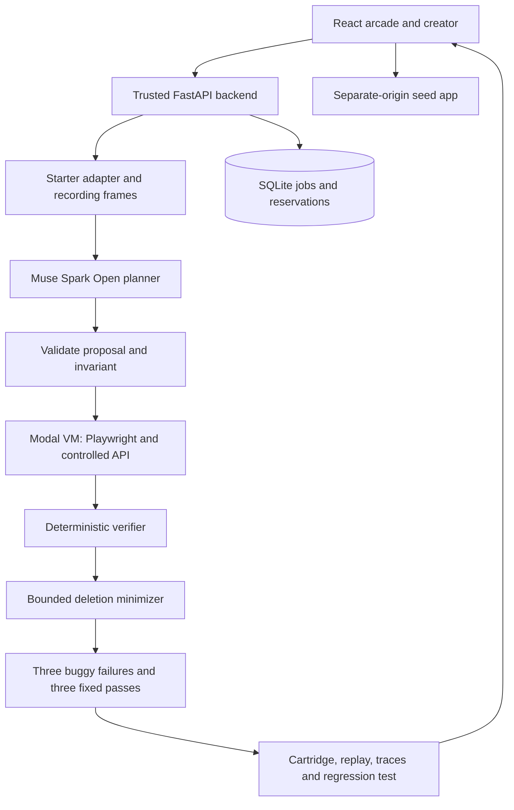

# Architecture

BugArcade has two connected workflows: a player discovers a bug in a small app; an investigation pipeline turns a reproducible failure into a playable challenge and regression test. Both use the same action vocabulary, controlled request schedule and deterministic assertion.

## Components

| Module | Responsibility |
| --- | --- |
| `backend/adapter.py`, `schemas.py` | Validate the allowlisted Starter v1 archive and typed boundary data |
| `backend/recording.py`, `media_worker.py` | Decode the recording in a bounded subprocess and extract four timestamped frames |
| `backend/planner.py`, `config.py` | Call the selected model provider from the trusted backend; validate the response |
| `backend/jobs.py`, `store.py` | Persist job state, idempotency, concurrency and budget reservations |
| `backend/runner.py`, `cgroup_guard.py` | Own Modal lifecycle, resource limits, input binding and protected receipts |
| `worker/executor.mjs`, `validation.mjs` | Execute supported actions and evaluate the immutable assertion |
| `worker/minimizer.mjs` | Try bounded action deletions against both app variants |
| `backend/packaging.py`, `artifact_transfer.py` | Verify artifact transport and assemble replay, test and playable cartridge |
| `frontend/`, `fixtures/` | Player experience and five authored buggy/fixed React pairs |

FastAPI, SQLite and file artifacts keep this a single-user workbench without a distributed queue. Run one backend worker. The frontend and fixture server are separate origins; iframe messages are checked against the active frame, challenge and variant.

## What the model decides

Muse receives buggy source, declared targets, the authorized invariant, controlled network schedule, optional hints and four recording frames with decoded timestamps. It proposes `click`, `fill`, `release` and state-synchronized `wait` actions, plus a candidate assertion. Actions target declared test IDs, never arbitrary JavaScript, shell commands, URLs or selectors.

The manifest's assertion and completion checkpoint are frozen before execution. A model candidate must match that invariant. A canonical hash follows it through browser execution, minimization and packaging. The backend also validates the observed value and verdict. Source comments, hints and model output cannot change security policy or grant authority.

The recording is evidence to interpret, not proof of reproduction. A completed workflow with a false invariant counts as reproduced; timeout, missing completion, app exception or infrastructure failure does not. A shorter sequence is accepted only when buggy fails and fixed passes under the same invariant and schedule. The bounded deletion search does not claim a globally shortest sequence.

## Bounded jobs

Jobs follow `queued → preparing → investigating → reproducing → minimizing → validating`, then `completed`, `not-reproduced`, `failed` or `cancelled`. A retry may return from reproducing to investigating. Duplicate idempotency keys reuse a job; conflicting input returns 409. Startup marks interrupted work as recoverable failed. Cancellation awaits runner cleanup.

Defaults allow one executing job, four queued/active jobs, 12 actions, two model calls, 20 minimization probes, 2,048 requested output tokens, a 300-second job deadline and 45 seconds per sandbox. The planner bounds prompt text and image admission. SQLite reserves conservative worst-case model and runtime costs before dispatch. These controls limit this application's requests; they are not a provider invoice cap.

## Providers and execution

The captured live investigations used Meta Muse Spark Open through a Modal Shared Endpoint. The provider/model identifier is configurable. Baseten's compatible route is implemented but has not been verified with a live key. There is no automatic provider fallback. Model calls run outside submitted-code sandboxes, and credentials are absent from app code, browser sessions, images and exported tests.

The local runner executes only trusted shipped fixtures. Submitted apps use a prebuilt Modal VM with external egress disabled, a non-root workload and a protected resource observer. See [security boundaries](SECURITY.md). Sharing a JSON execution interface does not make the local process an equivalent isolation boundary.

## Evidence and playback

Every accepted result binds source hashes, dependency/browser versions, seed, network schedule, assertion, executed actions and provenance. The package contains `challenge.json`, `replay.json`, source ZIP, regression test, run records, trace, screenshots, recording and standalone buggy/fixed cartridges.

Cartridge playback runs a bundled app and in-memory simulator in a scripts-only opaque iframe. It makes no new model call and is not a new verification run. The five gallery plans are authored; two separate [captured Meta investigations](EVIDENCE.md) demonstrate model proposals actually driving browser actions.
